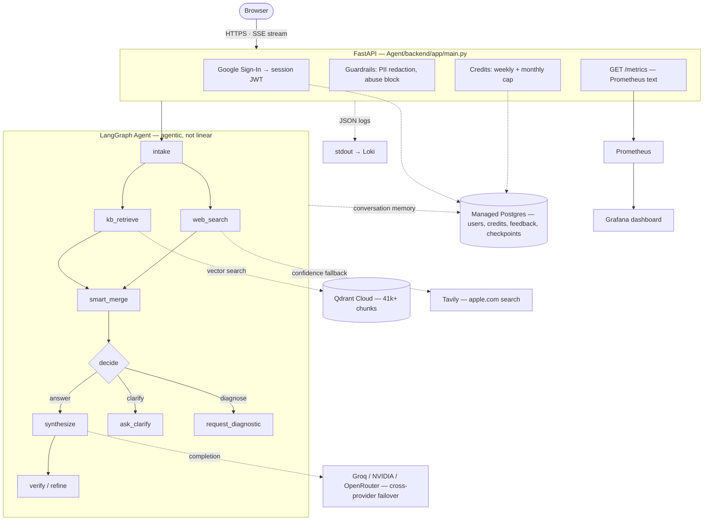

# macOS Troubleshooting RAG System

[](https://macos-agent-hari.duckdns.org/)
[](pyproject.toml)
[](Agent/backend/app/agent/graph.py)
[](Agent/backend/app/main.py)
[](vectorDBIngestion/)
[](deploy/oracle/)

An agentic RAG system that diagnoses macOS problems using a smaller open model
(Llama-3.3-70B via Groq) backed by a deep, narrow, well-structured knowledge
base — then measures itself against frontier models instead of assuming it wins.

**→ Try it: [macos-agent-hari.duckdns.org](https://macos-agent-hari.duckdns.org/)**
· chat UI at [`/app`](https://macos-agent-hari.duckdns.org/app)
· [`/metrics`](https://macos-agent-hari.duckdns.org/metrics) is live Prometheus text

**The thesis under test:** on a narrow domain, precise retrieval plus
solution-depth triage can substitute for raw model size. Data quality is the
product; the model is replaceable.

**What the benchmark actually found:** the thesis holds *multi-turn* and fails
*single-turn*. Numbers below — they are committed in the repo, not claimed.

---

## Results

Two benchmarks, both reproducible from the repo, both blind-labelled and judged
by a panel of two independent open models (GPT-OSS-120B and Qwen3-32B on Groq —
neither is a contestant). Reports:
[`benchmark_report.json`](Agent/eval/results/benchmark_report.json),
[`interactive_report.json`](Agent/eval/results/interactive_report.json),
[`transcripts.md`](Agent/eval/results/transcripts.md).

### Multi-turn conversation — the agent wins

A simulated user starts vague and answers follow-up questions, which is the
shape the product actually ships in.
([`interactive_bench.py`](Agent/eval/interactive_bench.py), n=4)

| | Resolved | Avg. turns to resolve |
|---|---|---|
| **This agent** | **2 / 4 (50%)** | **2.25** |
| Raw GPT-4o | 1 / 4 (25%) | 3.25 |

Both judges independently scored it 2–1 in the agent's favour. This is the
number the [regression gate](Agent/eval/regression_gate.py) enforces on every
change, via [`baseline.json`](Agent/eval/baseline.json).

### Single-turn one-shot answers — the agent loses

One expert-level question, one answer, no follow-ups.
([`benchmark.py`](Agent/eval/benchmark.py), n=6)

| Judge | vs. GPT-4o | vs. raw Llama-70B |
|---|---|---|
| GPT-OSS-120B | 1W / 0T / 5L | 1W / 2T / 3L |
| Qwen3-32B | 0W / 0T / 3L | 1W / 0T / 2L |

Per-dimension means, 0–5, GPT-OSS-120B judge:

| | Correctness | Actionability | Depth triage | Grounding |
|---|---|---|---|---|
| This agent | 1.67 | 2.67 | 3.67 | 2.17 |
| Raw GPT-4o | **3.50** | **4.67** | **4.50** | **3.83** |
| Raw Llama-70B | 2.33 | 3.50 | 3.83 | 3.00 |

Inter-judge agreement: 0.667.

### Reading the split honestly

- **Depth triage is the one dimension the agent is competitive on** (3.67 vs
  Llama-70B's 3.83) — which is exactly what the `difficulty_tier` design was
  for. The mechanism works; it just does not rescue a wrong retrieval.
- **Correctness and grounding are where it loses.** On questions demanding
  exact syntax — the precise `log show --predicate` quoting, for instance —
  retrieval surfaces a near-miss chunk and the synthesiser commits to it
  confidently. A frontier model with no knowledge base simply knows the answer.
- **The multi-turn win comes from the case file, not the corpus.** Accumulating
  macOS version, chip and already-tried steps lets it ask for the missing
  detail instead of guessing, and it resolves in fewer turns.
- **n=4 and n=6 are too small to settle anything.** These are directional
  results from a hand-written question set, not an evaluation at scale. Growing
  the set is the honest next step.

---

## Architecture



One database backs everything stateful: `users` / `credit_accounts` /
`usage_log` / `feedback` (Alembic-managed relational schema) **and**, as of
V3, the LangGraph conversation checkpointer itself — so multi-turn memory
(macOS version, chip, already-tried steps, the running case file) survives a
restart or redeploy instead of living only in process RAM. See
[`Agent/backend/app/agent/graph.py`](Agent/backend/app/agent/graph.py)
(`make_memory_checkpointer`) and [`Agent/DEPLOY.md`](Agent/DEPLOY.md).

## Distinctive features

- **Solution-depth triage** — every KB entry carries a `difficulty_tier`; the
  agent infers what the user has already tried and never leads with the obvious.
- **Multi-turn case file** — macOS version, chip, and already-tried steps
  accumulate across turns, so follow-ups escalate depth instead of restarting.
- **Confidence-gated web fallback** — RAG first; Tavily (scoped to apple.com)
  only when retrieval confidence is low.
- **Blind head-to-head benchmark** — agent vs. raw GPT-4o vs. raw Llama-70B,
  contestants label-shuffled per question, scored by two independent judges on
  a four-dimension rubric, with a regression gate wired into the build.

## Quickstart

Requires Python 3.12+ and [`uv`](https://docs.astral.sh/uv/).

```bash
git clone https://github.com/Harichandra1/macos-agent.git
cd macos-agent
uv sync
cp .env.example .env          # fill in credentials

cd Agent/backend && ../../.venv/bin/uvicorn app.main:app --port 8000
# → http://localhost:8000      landing page
# → http://localhost:8000/app  chat UI
```

Reproduce the benchmarks (needs provider keys; answers are cached):

```bash
cd Agent/eval
python benchmark.py                       # single-turn, 3-way, 2 judges
python benchmark.py --no-cache            # regenerate answers + re-judge
python interactive_bench.py               # multi-turn resolution
python regression_gate.py                 # fail the build on a regression
```

## Monorepo layout

| Subproject | Path | Role |
|------------|------|------|
| **Ingestion (write path)** | [`vectorDBIngestion/`](vectorDBIngestion/) | Scrape 11 sources → clean/tag → chunk (1 doc = 1 problem-solution) → embed → Qdrant Cloud (41k+ chunks). |
| **Agent (read/serve path)** | [`Agent/`](Agent/) | LangGraph agent + FastAPI (SSE) + landing page + web chat UI + the head-to-head benchmark. |
| **Evaluation** | [`Agent/eval/`](Agent/eval/) | Question set, blind 3-way benchmark, interactive benchmark, retrieval eval, regression gate, committed reports. |
| **Observability** | [`observability/`](observability/) | Prometheus scrape config + provisioned Grafana dashboard (docker-compose for local use). |

Shared config (`.env`, `pyproject.toml`, `uv.lock`, `.venv`) lives at the root.
See [`CLAUDE.md`](CLAUDE.md) for the full design contract,
[`Agent/README.md`](Agent/README.md) to run the serving layer and benchmark,
and [`Agent/DEPLOY.md`](Agent/DEPLOY.md) for the production deploy runbook.

## Build phases

| # | Phase | Delivers |
|---|-------|----------|
| 1 | Auth & core engine | Google OAuth → session JWT, Postgres (users), rolling-summary conversation memory |
| 2 | Guardrails & resilience | PII redaction, prompt-abuse blocking, exponential-backoff + quota-aware provider errors |
| 3 | Credits & live status | Weekly (5/user) + monthly ($0.25 cap) credit system backed by exact per-turn token/cost accounting, SSE progress states |
| 4 | Observability, evals, feedback | Prometheus `/metrics`, Grafana dashboard, thumbs up/down feedback, an eval-benchmark regression gate |
| 5 | Deployment | Dockerized service + Alembic migrations-on-boot, `render.yaml` blueprint (web + managed Postgres + cron), smoke tests |

V3 closes the one gap Phase 5 left open — conversation memory now persists in
the same managed Postgres, not an in-process cache.

## Zero-cost production path

The active deployment target is an Oracle Always Free VM running the Docker
stack in [`deploy/oracle/`](deploy/oracle/): Caddy terminates HTTPS, FastAPI is
private, and Grafana Alloy forwards private metrics and Docker logs to Grafana
Cloud. Neon Postgres stores users, credits, feedback, and durable LangGraph
checkpoints. Oracle may reclaim a VM that remains idle; recovery is reproducible
from Git and does not lose Neon state.

## Roadmap

- Grow the eval set well past n=6 — the current numbers are directional only.
- Attack the correctness/grounding gap: rerank retrieved chunks and make the
  synthesiser abstain rather than commit when grounding is weak.
- Re-run the single-turn benchmark after reranking and publish the delta here.
